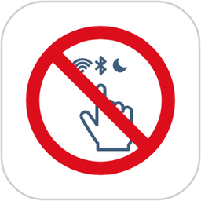
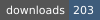
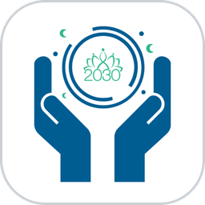
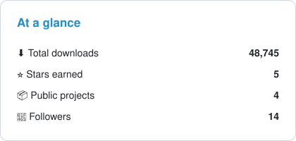
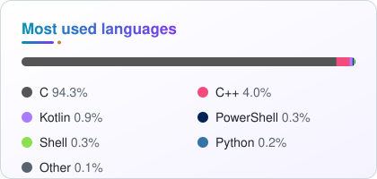

  <b>العربية</b> · <a href="https://github.com/2B-4G10">English</a> · <a href="https://github.com/2B-4G10/2B-4G10/blob/main/README.zh-CN.md">简体中文</a>

<!-- The banner is cut into linked slices so each app icon opens its own page. -->

 

## 👋 نبذة عني

- 🛸 أطوّر **[Re: TeleVIP](https://github.com/Dream1Works/Re-TeleVIP)**، وهي وحدة للخصوصية وحظر الإعلانات في Telegram والنسخ المعدّلة منه.
- 🔐 أحب خفايا نظام Android ووحدات الروت والحفاظ على خصوصية الهواتف.
- 🧩 معظم عملي خطافات Xposed تبقى تعمل مع تحديثات التطبيقات.
- 🇸🇦 أقيم في السعودية.

## 🚀 المشاريع

<table>
<tr>
  <td width="104" align="center" valign="middle">
    
  </td>
  <td valign="middle">
    <a href="https://github.com/Dream1Works/Re-TeleVIP"><b>Re: TeleVIP</b></a> &nbsp; 
    وضع الشبح، والرسائل المحذوفة، وحفظ القصص، وحظر الإعلانات، والمزيد في Telegram وNekogram وCherrygram و9 تطبيقات أخرى. وحدة Vector / LSPatch · <a href="https://re-televip.cc">re-televip.cc</a> 
    
    
    
    
    
  </td>
</tr>
<tr>
  <td width="104" align="center" valign="middle">
    
  </td>
  <td valign="middle">
    <a href="https://github.com/2B-4G10/NoLockQS"><b>NoLockQS</b></a> 
    يُبقي الإعدادات السريعة وقائمة التشغيل مقفلتين على شاشة القفل في هواتف Pixel ذات صلاحيات الروت. 
    
    
    
    
  </td>
</tr>
<tr>
  <td width="104" align="center" valign="middle">
    
  </td>
  <td valign="middle">
    <a href="https://github.com/2B-4G10/MVT-GUI"><b>MVT GUI</b></a> 
    افحص هواتف iPhone وAndroid بحثًا عن آثار برامج التجسس المعروفة، دون الحاجة إلى الطرفية (Terminal). لأجهزة Mac وWindows. 
    
    
    
    
  </td>
</tr>
<tr>
  <td width="104" align="center" valign="middle">
    
  </td>
  <td valign="middle">
    <a href="https://fmhub.org"><b>FMhub</b></a> منصة طب الأسرة 
    المنصة الجامعة لمقيمي طب الأسرة ومدربيهم في السعودية: برنامج الإقامة في JHAH، والكتاب الإلكتروني Family Medicine: The Essentials، ومؤتمرات Deep Dive، ومنتدى للمجتمع. بالعربية والإنجليزية · <a href="https://fmhub.org">fmhub.org</a> 
    
    
    
    
  </td>
</tr>
</table>

## 📊 الإحصائيات

<picture>
  <source media="(prefers-color-scheme: dark)" srcset="https://raw.githubusercontent.com/2B-4G10/2B-4G10/stats/overview-dark.svg">
  
</picture>
<picture>
  <source media="(prefers-color-scheme: dark)" srcset="https://raw.githubusercontent.com/2B-4G10/2B-4G10/stats/languages-dark.svg">
  
</picture>

تُحدَّث كل ست ساعات من مستودعاتي العامة.

## 🛠️ أدواتي

**لغات البرمجة** &nbsp;

**Android والأجهزة** &nbsp;

**النشر والتشغيل** &nbsp;

## 💛 ادعم عملي

مشاريعي مجانية، وأعمل عليها في أوقات أقتطعها من يومي ☕ إن كانت تفيدك، فكوب قهوة عبر Patreon أو Ko-fi يساعد على استمرارها.

 

صُنع في السعودية 🇸🇦 بواسطة: i_2B_4G10🚀

