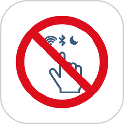
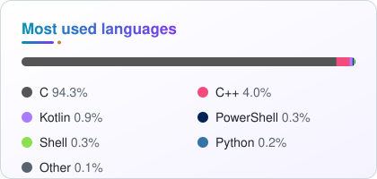

 

## 👋 About me

- 🛸 I build **[Re: TeleVIP](https://github.com/Dream1Works/Re-TeleVIP)**, a privacy and ad-blocking module for Telegram and its forks.
- 🔐 I like Android internals, root modules and keeping phones private.
- 🧩 Most of my work is Xposed hooks that keep working across app updates.
- 🇸🇦 Based in Saudi Arabia.

## 🚀 Projects

<table>
<tr>
  <td width="104" align="center" valign="middle">
    
  </td>
  <td valign="middle">
    <a href="https://github.com/Dream1Works/Re-TeleVIP"><b>Re: TeleVIP</b></a> &nbsp; 
    Ghost Mode, deleted messages, saved stories, ad blocking and more for Telegram, Nekogram, Cherrygram and 9 other clients. Vector / LSPatch module · <a href="https://re-televip.cc">re-televip.cc</a> 
    
    
    
    
    
  </td>
</tr>
<tr>
  <td width="104" align="center" valign="middle">
    
  </td>
  <td valign="middle">
    <a href="https://github.com/2B-4G10/NoLockQS"><b>NoLockQS</b></a> 
    Keeps Quick Settings and the power menu locked on the lock screen of rooted Pixel phones. 
    
    
    
    
  </td>
</tr>
<tr>
  <td width="104" align="center" valign="middle">
    
  </td>
  <td valign="middle">
    <a href="https://github.com/2B-4G10/MVT-GUI"><b>MVT GUI</b></a> 
    Check iPhones and Android phones for traces of known spyware, without the Terminal. For Mac and Windows. 
    
    
    
    
  </td>
</tr>
<tr>
  <td width="104" align="center" valign="middle">
    
  </td>
  <td valign="middle">
    <a href="https://github.com/2B-4G10/Xbloom-Panel"><b>xBloom Panel</b></a> by Double Shot 
    A touchscreen for the xBloom Studio coffee machine: recipes, brewing, grinder and scale at your fingertips, in English or العربية. Firmware for the Elecrow CrowPanel Advance 4.3″. 
    
    
    
    
  </td>
</tr>
</table>

## 📊 Stats

<picture>
  <source media="(prefers-color-scheme: dark)" srcset="https://raw.githubusercontent.com/2B-4G10/2B-4G10/stats/overview-dark.svg">
  
</picture>
<picture>
  <source media="(prefers-color-scheme: dark)" srcset="https://raw.githubusercontent.com/2B-4G10/2B-4G10/stats/languages-dark.svg">
  
</picture>

Updated every six hours from my public repos.

## 🛠️ Tools I use

**Languages** &nbsp;

**Android & devices** &nbsp;

**Ship & run** &nbsp;

## 💛 Support my work

My projects are free and made in squeezed-in time ☕ If they help you, a coffee on Patreon keeps them going.

 

Made in Saudi 🇸🇦 By: i_2B_4G10🚀

