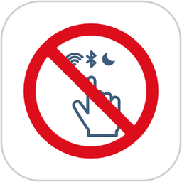
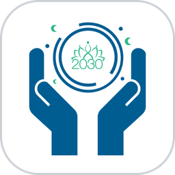
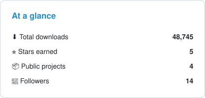
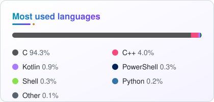

  <a href="https://github.com/2B-4G10/2B-4G10/blob/main/README.ar.md">العربية</a> · <a href="https://github.com/2B-4G10">English</a> · <b>简体中文</b>

<!-- The banner is cut into linked slices so each app icon opens its own page. -->

 

## 👋 关于我

- 🛸 我开发了 **[Re: TeleVIP](https://github.com/Dream1Works/Re-TeleVIP)**，一个为 Telegram 及其分支客户端提供隐私保护和广告拦截的模块。
- 🔐 我喜欢研究 Android 系统内部机制、Root 模块，以及如何让手机更私密。
- 🧩 我的大部分工作是编写 Xposed 钩子，并让它们在应用更新后依然有效。
- 🇸🇦 现居沙特阿拉伯。

## 🚀 项目

<table>
<tr>
  <td width="104" align="center" valign="middle">
    
  </td>
  <td valign="middle">
    <a href="https://github.com/Dream1Works/Re-TeleVIP"><b>Re: TeleVIP</b></a> &nbsp; 
    为 Telegram、Nekogram、Cherrygram 及另外 9 个客户端提供幽灵模式、查看已删除消息、保存动态、广告拦截等功能。Vector / LSPatch 模块 · <a href="https://re-televip.cc">re-televip.cc</a> 
    
    
    
    
    
  </td>
</tr>
<tr>
  <td width="104" align="center" valign="middle">
    
  </td>
  <td valign="middle">
    <a href="https://github.com/2B-4G10/NoLockQS"><b>NoLockQS</b></a> 
    在已 Root 的 Pixel 手机上，让锁屏时的快捷设置和电源菜单保持锁定。 
    
    
    
    
  </td>
</tr>
<tr>
  <td width="104" align="center" valign="middle">
    
  </td>
  <td valign="middle">
    <a href="https://github.com/2B-4G10/MVT-GUI"><b>MVT GUI</b></a> 
    无需使用终端（Terminal），即可检查 iPhone 和 Android 手机上是否有已知间谍软件的痕迹。支持 Mac 和 Windows。 
    
    
    
    
  </td>
</tr>
<tr>
  <td width="104" align="center" valign="middle">
    
  </td>
  <td valign="middle">
    <a href="https://fmhub.org"><b>FMhub</b></a> 家庭医学中心 
    面向沙特阿拉伯家庭医学住院医师和带教老师的平台：JHAH 住院医师培训项目、电子书 Family Medicine: The Essentials、Deep Dive 学术会议以及社区论坛。提供英文和阿拉伯文版本 · <a href="https://fmhub.org">fmhub.org</a> 
    
    
    
    
  </td>
</tr>
</table>

## 📊 统计

<picture>
  <source media="(prefers-color-scheme: dark)" srcset="https://raw.githubusercontent.com/2B-4G10/2B-4G10/stats/overview-dark.svg">
  
</picture>
<picture>
  <source media="(prefers-color-scheme: dark)" srcset="https://raw.githubusercontent.com/2B-4G10/2B-4G10/stats/languages-dark.svg">
  
</picture>

根据我的公开仓库，每六小时更新一次。

## 🛠️ 我使用的工具

**编程语言** &nbsp;

**Android 与设备** &nbsp;

**发布与运行** &nbsp;

## 💛 支持我的工作

我的项目全部免费，都是利用挤出来的时间做的 ☕ 如果它们对你有帮助，欢迎在 Patreon 或 Ko-fi 请我喝杯咖啡，支持它们继续下去。

 

沙特制造 🇸🇦 作者：i_2B_4G10🚀

